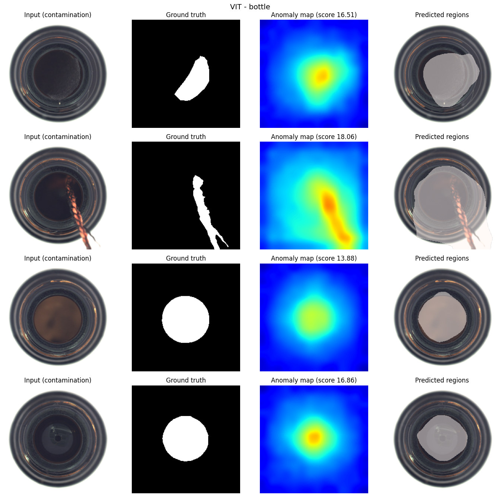
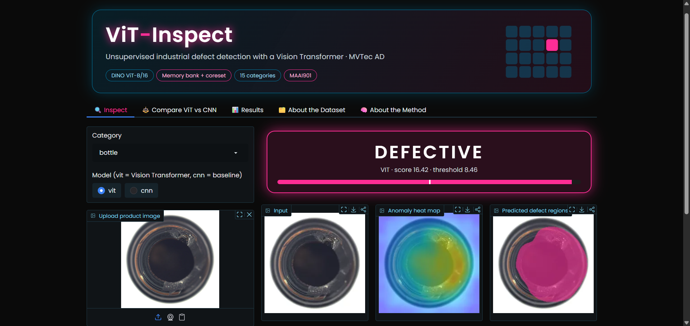
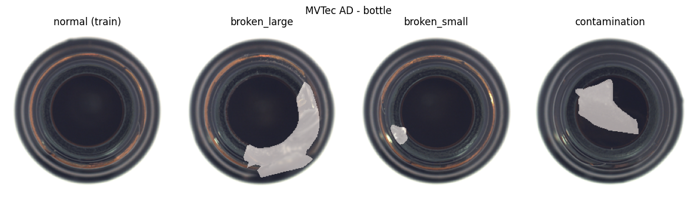
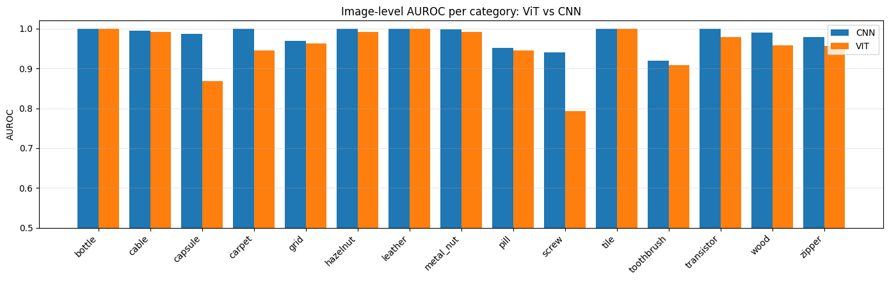
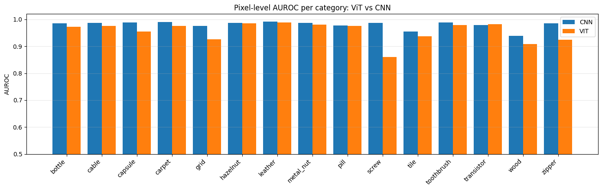
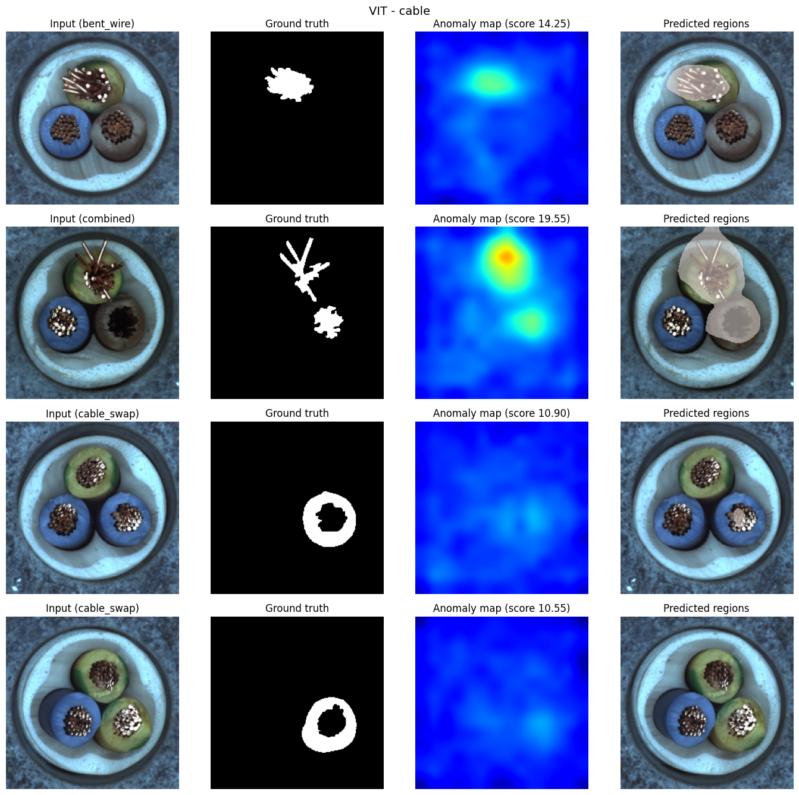
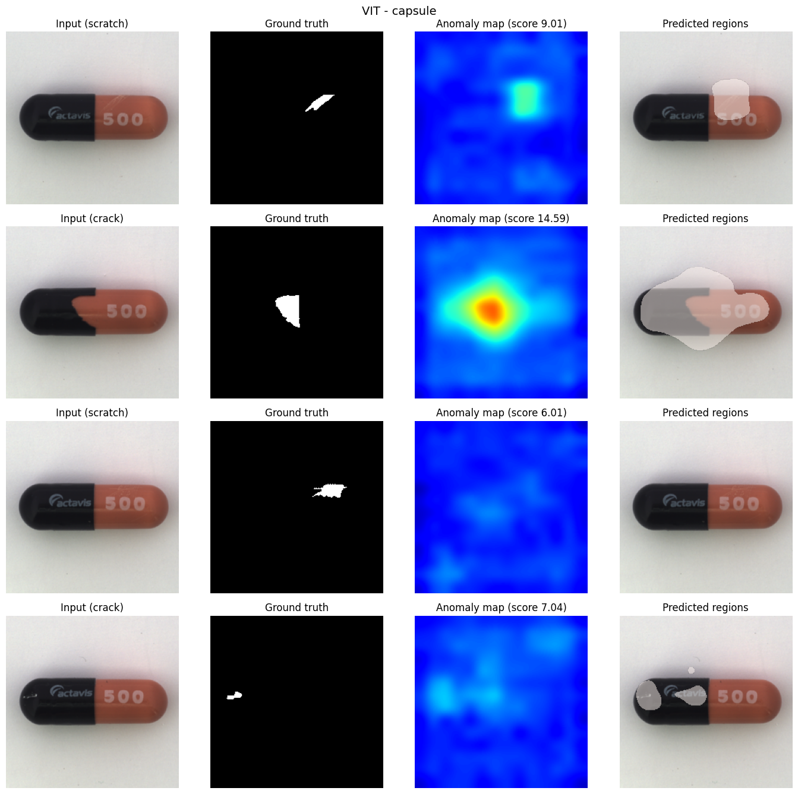
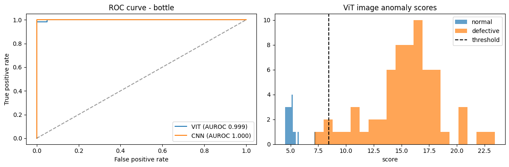

# ViT-Inspect: Unsupervised Industrial Anomaly Detection on MVTec AD using a Vision Transformer


-FF2D95?style=flat-square)


ViT-Inspect detects **defects in industrial products** (scratches, cracks, dents, contamination, missing parts) and shows **where** they are with a heat map.
It uses a **frozen, pretrained Vision Transformer** and is trained on **normal images only**. No defective image or mask is used for training.

[](https://colab.research.google.com/github/Vvanunagesh09/vit-inspect-mvtec-anomaly-detection/blob/main/ViT_Inspect_MVTec_AD.ipynb)

> Course project: *Deep Learning for Visual Data (MAAI901)*, University of Wollongong in Dubai.



<!-- Add your own UI screenshot here after uploading it to the results folder:
 -->
## 🖥️ Application Preview

The ViT-Inspect interface displays industrial inspection results, including the input image, anomaly heatmap, predicted defect region, and classification result.


---

## Table of contents
1. [Problem](#problem)
2. [Method](#method)
3. [Dataset (Hugging Face)](#dataset-hugging-face)
4. [Results](#results)
5. [Interactive UI](#interactive-ui)
6. [How to run](#how-to-run)
7. [Repository structure](#repository-structure)
8. [Limitations and future work](#limitations-and-future-work)
9. [References](#references)
10. [License and acknowledgements](#license-and-acknowledgements)

---

## Problem
In a factory, defective products are rare and look different every time, so we cannot collect enough defect examples to train a normal classifier.
**Unsupervised anomaly detection** learns what *normal* looks like, and anything that does not match is flagged.

For every test image the project answers:
* **Image level:** is the product normal or defective?
* **Pixel level:** which region is defective? (anomaly heat map)

## Method
The pipeline follows the PatchCore idea, with a Vision Transformer as the feature extractor.

1. **Patchify:** the image (224x224) is cut into 16x16 patches, a 14x14 grid.
2. **ViT features:** a frozen **DINO ViT-B/16** (`facebook/dino-vitb16`) gives every patch a feature vector. Self-attention lets each patch see the whole image. Features come from transformer blocks **8 and 11** (concatenated, 1536 dimensions).
3. **Memory bank:** patch features of all **normal training images** are collected and compressed with **greedy k-center coreset sampling** (10%).
4. **Scoring:** for every test patch, the distance to its **nearest neighbour** in the memory bank is computed. Far from all normal patches means anomalous.
5. **Output:** patch distances are upsampled and Gaussian-smoothed into an **anomaly map** (pixel level). The **maximum** of the map is the **image score** (image level).

A **CNN baseline (WideResNet-50, layer2 + layer3, 28x28 grid)** runs through the same pipeline for comparison. An **ablation** compares which ViT layers to use.

**Metrics:** Image AUROC and Pixel AUROC.

## Dataset (Hugging Face)
The data is **MVTec AD** (Bergmann et al., CVPR 2019), the standard benchmark for industrial visual inspection.
It is downloaded automatically in the notebook from the Hugging Face dataset **[`foersben/mvtec-ad`](https://huggingface.co/datasets/foersben/mvtec-ad)** using `huggingface_hub.snapshot_download`:

```python
snapshot_download(repo_id="foersben/mvtec-ad", repo_type="dataset",
                  local_dir="/content/mvtec_ad",
                  allow_patterns=[f"{c}/*" for c in CATEGORIES])   # all 15 categories, 6,642 files
```

> This Hugging Face repository is a community upload of MVTec AD. The original dataset is published by MVTec Software GmbH (mvtec.com).

* **15 categories:** 5 textures (carpet, grid, leather, tile, wood) and 10 objects (bottle, cable, capsule, hazelnut, metal_nut, pill, screw, toothbrush, transistor, zipper).
* **Folder structure:**
```
category/
├── train/good/                    normal training images
├── test/good/                     normal test images
├── test/<defect_type>/            defective test images
└── ground_truth/<defect_type>/    pixel masks (xxx_mask.png)
```

### What is used for training and what for testing
| Split | Images | Used for |
|---|---|---|
| **Train** | 3,629 (normal only) | Building the memory bank |
| **Test: normal** | 467 | Checking false alarms |
| **Test: defective** | 1,258 (with pixel masks) | Evaluation only |

The model **never sees a defective image or a mask during training**. Total test images: 1,725.

<details>
<summary>Per-category image counts (printed by the notebook)</summary>

| Category | Train normal | Test normal | Test defective | Defect types |
|---|---|---|---|---|
| bottle | 209 | 20 | 63 | 3 |
| cable | 224 | 58 | 92 | 8 |
| capsule | 219 | 23 | 109 | 5 |
| carpet | 280 | 28 | 89 | 5 |
| grid | 264 | 21 | 57 | 5 |
| hazelnut | 391 | 40 | 70 | 4 |
| leather | 245 | 32 | 92 | 5 |
| metal_nut | 220 | 22 | 93 | 4 |
| pill | 267 | 26 | 141 | 7 |
| screw | 320 | 41 | 119 | 5 |
| tile | 230 | 33 | 84 | 5 |
| toothbrush | 60 | 12 | 30 | 1 |
| transistor | 213 | 60 | 40 | 4 |
| wood | 247 | 19 | 60 | 5 |
| zipper | 240 | 32 | 119 | 7 |

</details>



## Results
All 15 categories, one run, seed 42, Tesla T4 GPU in Google Colab.

| Backbone | Mean Image AUROC | Mean Pixel AUROC |
|---|---|---|
| DINO ViT-B/16 (ours) | **0.9527** | **0.9550** |
| WideResNet-50 (CNN baseline) | **0.9818** | **0.9802** |

**Per category**

| Category | ViT image | CNN image | ViT pixel | CNN pixel |
|---|---|---|---|---|
| bottle | 0.9992 | 1.0000 | 0.9727 | 0.9850 |
| cable | 0.9921 | 0.9944 | 0.9750 | 0.9867 |
| capsule | 0.8688 | 0.9876 | 0.9544 | 0.9879 |
| carpet | 0.9458 | 0.9992 | 0.9750 | 0.9902 |
| grid | 0.9624 | 0.9691 | 0.9264 | 0.9752 |
| hazelnut | 0.9921 | 1.0000 | 0.9846 | 0.9870 |
| leather | 1.0000 | 1.0000 | 0.9877 | 0.9920 |
| metal_nut | 0.9922 | 0.9980 | 0.9809 | 0.9863 |
| pill | 0.9446 | 0.9523 | 0.9764 | 0.9775 |
| screw | 0.7932 | 0.9399 | 0.8596 | 0.9875 |
| tile | 0.9996 | 1.0000 | 0.9375 | 0.9553 |
| toothbrush | 0.9083 | 0.9194 | 0.9783 | 0.9886 |
| transistor | 0.9783 | 0.9992 | 0.9828 | 0.9787 |
| wood | 0.9579 | 0.9895 | 0.9084 | 0.9395 |
| zipper | 0.9561 | 0.9785 | 0.9247 | 0.9851 |
| **Mean** | **0.9527** | **0.9818** | **0.9550** | **0.9802** |




### Honest reading of the results
* The **ViT pipeline works well** (mean image AUROC 0.953, perfect or near-perfect on bottle, leather, tile, hazelnut, metal_nut, cable), but in this setup the **CNN baseline scored higher on average** (0.982 vs 0.953 image, 0.980 vs 0.955 pixel). The ViT was ahead only for transistor at pixel level (0.983 vs 0.979), and tied on leather at image level.
* The largest gaps are on **screw** (0.793 vs 0.940 image) and **capsule** (0.869 vs 0.988 image), which have small defects. A likely reason is that the ViT works on a **coarse 14x14 patch grid** while the CNN uses a **28x28 grid**, so small defects are harder to localise. This explanation is plausible but **was not tested** here; the two models also differ in more than resolution.
* Because backbone and grid resolution differ together, this experiment does not isolate "ViT vs CNN" in general. It compares these two specific configurations.

### Ablation: which ViT layers? (bottle only)
| Layers | Image AUROC | Pixel AUROC |
|---|---|---|
| block 4 (early) | 1.0000 | 0.9838 |
| block 8 (middle) | 1.0000 | 0.9752 |
| block 11 (late) | 0.9992 | 0.9697 |
| blocks 8+11 (used) | 0.9992 | 0.9727 |
| blocks 4+8+11 | 0.9992 | 0.9743 |

The differences are small and come from **one category only**, so they are not conclusive. On bottle, the early block gave the best pixel AUROC, so the layer choice (8+11) used for all categories was not proven to be optimal.

### More figures
| | |
|---|---|
|  |  |
|  | |

**Notes**
* The decision threshold is chosen from test scores (Youden's J), so accuracy at the threshold is slightly optimistic. AUROC does not depend on it.
* Single run per setting, no confidence intervals.
* Runtime on a Colab T4 (from the notebook logs): about 5 minutes for all 15 categories with the ViT and about 15 minutes with the CNN.

## Interactive UI
A Gradio app with a dark theme (jet black `#0A0A0A`, cerulean blue `#007BA7`, neon rose `#FF2D95`) and five tabs:

| Tab | What it does |
|---|---|
| 🔍 Inspect | Choose category and model, upload or pick a random test image, see NORMAL/DEFECTIVE, heat map and predicted regions. Live **sensitivity** and **opacity** sliders. Download the heat map. |
| ⚖️ Compare ViT vs CNN | Same image through both models, side by side. |
| 📊 Results | AUROC tables, comparison graphs, ablation table. |
| 🗂️ About the Dataset | Dataset description, train/test usage, counts chart, category gallery with defect masks. |
| 🧠 About the Method | Step-by-step explanation of the pipeline. |

The UI needs the notebook to be run first in the **same Colab runtime** (it reuses the saved memory banks and functions). It was tested with Gradio 6.x, which prints a deprecation warning about `theme`, `css` and `js` moving to `launch()`; the app still runs.

## How to run
Designed for **Google Colab** with a free **T4 GPU** (tested on Python 3.13).

1. Open `ViT_Inspect_MVTec_AD.ipynb` in Colab (**File > Upload notebook**).
2. Set **Runtime > Change runtime type > T4 GPU**.
3. Test first with `CATEGORIES = ["bottle"]` in Step 1, then switch to all 15 categories.
4. Run the cells from top to bottom. The notebook downloads the dataset from Hugging Face, builds the memory banks, evaluates both backbones, and saves results to `/content/outputs`.
5. For the UI, run `pip install gradio`, then run the UI cell (also provided as `vit_inspect_ui.py`) and open the public `gradio.live` link.

```bash
git clone https://github.com/Vvanunagesh09/vit-inspect-mvtec-anomaly-detection.git
```

**Main settings** (Step 1)

| Setting | Value used | Meaning |
|---|---|---|
| `IMG_SIZE` | 224 | Input size (14x14 patch grid for the ViT) |
| `CORESET_RATIO` | 0.10 | Share of patch features kept in the memory bank |
| `VIT_LAYERS` | [8, 11] | Transformer blocks used for features |
| `GAUSS_SIGMA` | 4 | Smoothing of the anomaly map |
| `RUN_CNN_BASELINE` | True | Also run the WideResNet-50 baseline |
| `SEED` | 42 | Random seed |

## Repository structure
```
vit-inspect-mvtec-anomaly-detection/
├── ViT_Inspect_MVTec_AD.ipynb     pipeline, evaluation, plots 
├── vit_inspect_ui.py              Gradio interactive app 
├── results/                       figures from the notebook 
└── README.md
```
The dataset and the saved `.pt` memory banks are **not** included (large files). The notebook recreates them.

## Limitations and future work
* The ViT patch grid is coarse (14x14), so **small defects** (screw, capsule) are harder. Running the ViT at a higher resolution (for example 448) is the first experiment to try, to check whether grid resolution explains the gap to the CNN.
* The ablation covers only one category. Repeat it on several categories before drawing conclusions about the best layers.
* One model per category. A photo with very different lighting or background from MVTec will often be flagged as defective (domain shift).
* Future work: DINOv2 or CLIP backbones, higher resolution, fine-tuning with synthetic anomalies, and a permanently hosted app (for example Hugging Face Spaces).

## References
* P. Bergmann et al., *MVTec AD: A Comprehensive Real-World Dataset for Unsupervised Anomaly Detection*, CVPR 2019.
* K. Roth et al., *Towards Total Recall in Industrial Anomaly Detection (PatchCore)*, CVPR 2022.
* M. Caron et al., *Emerging Properties in Self-Supervised Vision Transformers (DINO)*, ICCV 2021.
* A. Dosovitskiy et al., *An Image is Worth 16x16 Words: Transformers for Image Recognition at Scale (ViT)*, ICLR 2021.

## License and acknowledgements
* MVTec AD is licensed under **CC BY-NC-SA 4.0** (non-commercial use only). Please credit MVTec Software GmbH.
* Pretrained models: DINO ViT-B/16 (Hugging Face `facebook/dino-vitb16`) and WideResNet-50 (torchvision, ImageNet weights).
* Add a license for your own code (for example MIT) if you want others to reuse it.

**Author:** V Anu
